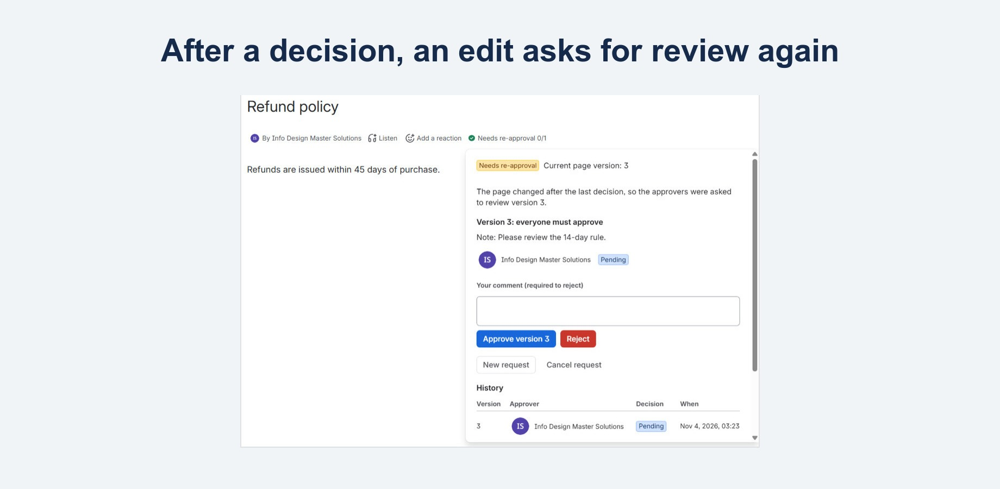

# Reapprove for Confluence: user guide

Reapprove is a Confluence Cloud app by Design Master Solutions. Page approvals are tied to the page version: when someone edits an approved page, the approval stops counting and the same approvers are asked to review the new version. This repository holds the public documentation and is the place to report problems.

Install: https://marketplace.atlassian.com/apps/3231212993/reapprove-for-confluence · 2-minute demo: https://youtu.be/lB8UTtduQe8

## Ask for approval

1. Open a Confluence page. Under the title, click **Request approval** (it shows the current state, for example *Not requested*).
2. In **Approvers**, choose 1 to 20 people other than yourself. If that click refuses, the panel shows the sentence in [When Request approval refuses the form](#when-request-approval-refuses-the-form).
3. Under **Rule**, choose **Everyone must approve** or **Any one approver is enough**.
4. Add an optional **Note for the approvers** and click **Request approval of version N**.

The app adds a page comment with an @mention for the approvers. Bell and e-mail notification delivery depends on Confluence settings.

### When Request approval refuses the form

[Install Reapprove for Confluence](https://marketplace.atlassian.com/apps/3231212993/reapprove-for-confluence), then open a Confluence page and click the state under the title. If nothing has been requested, the form is already open. If the form is not on screen, click **New request**.

**Request approval of version N** stays enabled once you have chosen at least one person. It stays disabled while Approvers is empty, while a save is in progress, or while the subscription warning is on screen.

The click shows one red line. The round is not stored. The page does not get a comment. If more than one row below is true, you see the earliest row only.

| What you entered | What you see |
|---|---|
| An approver id that is not an Atlassian account id | **One of the approvers is not a valid Atlassian account.** |
| Approvers is empty | **Choose at least one approver.** The button stays disabled, so this line is the server answer. |
| You are one of the approvers | **You cannot approve your own request. Choose someone else.** |
| 21 different people, and you are not one of them | **At most 20 approvers per request.** |
| A rule other than everyone or any one approver | **Choose a rule: everyone or any one approver.** The menu only offers those two, so this line is the server answer. |
| A note of 501 characters after spaces at the ends are removed | **The note can have at most 500 characters.** |

You, plus 21 other people, plus a note of 501 characters, shows the own-request sentence. 21 other people and that same note shows the 20-person sentence. One other person and a note of 501 characters shows the note sentence.

A note of 500 characters is accepted. The same person picked twice counts as one, so two copies of one other person are not the 20-person sentence. A note of only spaces is stored as no note, and it is not the note sentence. A bad account id is shown even when you are also on the list and the note is too long.

An inactive subscription does not reach this table. That screen is [When the subscription is not active](#when-the-subscription-is-not-active).

If Confluence refuses the page on that click, the panel shows **This page is not available to you.** when the status is 404 or 403. Another status names the code, for example **Confluence 500 reading the page.** Those checks run before this table, so a refused page does not show the own-request sentence. A blog post shows **Reapprove works on pages.** A call that is not on a page shows **Open this from a Confluence page.** A blog post does not show that second sentence.

**Example input:** Approvers is you and one other person. The rule is **Everyone must approve**. The note is empty. The subscription is active, or this is a development install with no license object.

**Result:** `You cannot approve your own request. Choose someone else.` Nothing is stored.

**Example input:** 21 other people, and the note is the letter x repeated 501 times.

**Result:** `At most 20 approvers per request.` Nothing is stored.

**Example input:** one other person, and the note is the letter x repeated 501 times.

**Result:** `The note can have at most 500 characters.` Nothing is stored.

Checked against `validateRequest` in production source `5f24f321` on 23 November 2026. `requestApproval` checks the license, then that the call is on a page, then reads the page, then runs this check, then stores the round and adds the comment. This is not a new click on a customer site.

If an approver has not answered after 3 days, Reapprove adds another comment that @mentions only the approvers still missing, and repeats it every 7 days while the request stays open. Each step is sent once. Reminders stop when the round completes (including one approval under the any-one rule or a rejection under either rule), or when the request is cancelled.

## Approve or reject

Open the page and click the state under the title. Click **Approve version N**, or write **Your comment** and click **Reject**. A rejection with a reason goes to the page history and to the reply comment. A **Reject** with no reason does not: see [When Reject has no reason](#when-reject-has-no-reason).

### When Reject has no reason

[Install Reapprove for Confluence](https://marketplace.atlassian.com/apps/3231212993/reapprove-for-confluence), then open a page where you are still a pending approver and click the state under the title.

**Example input:** the request is pending, **Your comment** is empty or only spaces, and you click **Reject**.

**Result:** the panel shows **Give a reason when you reject, so the author knows what to fix.** The request stays pending. History does not gain a rejection, and the page does not get a reply comment. Type a reason and click **Reject** again. That rejection ends the round under either rule, and the reason is stored.

Checked against the decision check in the published app on 22 November 2026. This is not a new click on a customer site.

## What happens when the page is edited

- The state under the title reads **Approved (vN)** while the page is still on the approved version.
- After an edit of a page someone has already answered, it reads **Needs re-approval**, and the same approvers are mentioned again to review the new version. An old note or reason does not carry into the new round. An edit before anyone answers does not use that label: the open request follows the new version, as the next point says.
- Adding or removing a label does not create a page version, so it does not reset the approval.
- A request nobody answered yet just follows the latest version, without new comments, so a burst of edits does not spam anyone.

The dialog uses two sentences of its own. See [When the page version moves past the decision](#when-the-page-version-moves-past-the-decision).

### When the page version moves past the decision

[Install Reapprove for Confluence](https://marketplace.atlassian.com/apps/3231212993/reapprove-for-confluence), then open a page that already has a decision and publish a new version.

**Example input:** version 3 was approved, or the latest round was rejected. The page is now version 4, and the new round is not stored yet. Open the state under the title.

**Result:** the dialog shows **The page changed after version 3, so that decision no longer applies.** The state under the title reads **Needs re-approval**. The number is the version that decision covered. If the subscription is not active, the app does not open the new round, so this sentence stays.

**Example input:** someone had already answered version 3, the subscription is active, and the app has stored the new round on version 4.

**Result:** the dialog shows **The page changed after the last decision, so the approvers were asked to review version 4.** With two approvers and no answer on version 4 yet, the state under the title reads **Needs re-approval 0/2**. The page comment is a different sentence: **This page changed (now version 4), so the previous decision no longer applies. Please review it again:** followed by the same approvers. The old note is not copied.

An edit before anyone has answered does not show either dialog sentence and does not add that comment. The open request follows the new version and stays **Approval pending**.

Checked against the published app on 23 November 2026. This is not a new click on a customer site.

The screen below is the Refund policy page on 4 Nov 2026, and it is highlight 1 of Marketplace version 2.0.0. A decision already existed. The page is on version 3, the rule is everyone must approve, and the state under the title reads Needs re-approval 0/1. The line above that screen is "After a decision, an edit asks for review again." An edit before anyone answers stays Approval pending and does not use this screen. The public file is [47489298-49fb-4881-8ea1-54120c71f88d](https://marketplace.atlassian.com/product-listing/files/47489298-49fb-4881-8ea1-54120c71f88d?width=1840&height=900). [Install Reapprove](https://marketplace.atlassian.com/apps/3231212993/reapprove-for-confluence), then open a test page your reviewers can see.

The person who asked can **Cancel request** while the request is pending. **New request** starts a round with other approvers or another rule, closing any pending decisions in the previous round while preserving History.

## Worked example: a procedure changes halfway through review

Use this example to check whether approval still covers the content your team will use. It is an illustrative scenario validated against the app's rules, not a customer approval record.

[Install Reapprove from the Marketplace](https://marketplace.atlassian.com/apps/3231212993/reapprove-for-confluence), then use a test Confluence page that the author and both reviewers can access. An admin handles installation and the subscription; check the Marketplace for current terms. You need an author and two different reviewers because the author cannot approve their own request.

**Input:** the author publishes “Supplier onboarding procedure”, version 7, and requests approval from Reviewer A and Reviewer B with **Everyone must approve**. The note is “Check the supplier verification steps.” Use your page's actual version number in place of 7.

| Action | Result to check under the page title |
|---|---|
| Submit the request for version 7 | Approval pending 0/2 |
| Reviewer A opens the status dialog and clicks Approve version 7 | Approval pending 1/2; one approval is not enough |
| The author changes a verification step and publishes version 8 | Needs re-approval until the update is processed; then Needs re-approval 0/2 |
| Both reviewers read version 8; Reviewer A approves it | Needs re-approval 1/2 |
| Reviewer B also approves version 8 | Approved (v8) |

Reload the page and reopen its status dialog after the edit. The new round uses the same two reviewers and the same everyone rule. Both must review again, including Reviewer A: the previous approval covered version 7. The old note does not carry into this round. The app adds a comment mentioning both reviewers; notification delivery follows Confluence settings.

**Check the record:** History retains Reviewer A's version 7 approval. Reviewer B's unanswered version 7 row is closed and appears as **Not needed** in the CSV, not Approved. Version 8 has two new decisions. Before both approve version 8, version 7 is not a previously approved version of the whole page: its everyone round never finished. After both approve version 8, the space's last approved version is 8.

For comparison, if the author edits before either reviewer answers, the pending round follows the new version silently, without a new mention comment. If a reviewer rejects, a reason is required and the round ends under either rule. Reapprove records review decisions; an approval is not a lock preventing future edits.

To try this with your team, [open the installation listing](https://marketplace.atlassian.com/apps/3231212993/reapprove-for-confluence), then follow **Ask for approval** above. Use test content and consenting reviewers: requests create real Confluence comments and mentions.

## Worked example: choose one reviewer or require both

Use **Any one approver is enough** when either selected person can sign off independently. Use **Everyone must approve** when both reviews are required. Neither rule is a majority vote. This illustrative example is validated against the app implementation; it is not a record of a live team review.

[Install Reapprove](https://marketplace.atlassian.com/apps/3231212993/reapprove-for-confluence), then open a test page accessible to its author and two consenting reviewers. An admin handles installation and the subscription under the current Marketplace terms. The author cannot be one of their own approvers.

**Input:** publish “Support handover”, version 3 (use your actual page version), open **Request approval**, choose Reviewer A and Reviewer B, select **Any one approver is enough**, add “Check the escalation contact”, and submit **Request approval of version 3**.

Run the following as separate rounds, not as actions in one completed round:

| Rule and action | Result |
|---|---|
| Any one: A approves while B has not answered | Approved (v3). B's unanswered row closes; the CSV calls it Not needed. |
| Any one: B rejects first with “Escalation contact is missing” | Rejected. A's unanswered row closes. A cannot rescue this round with a later approval. |
| Everyone: A approves while B has not answered | Approval pending 1/2. B still needs to review. |
| Everyone: B rejects after A approves | Rejected. History keeps A's approval and B's reason; the page is not approved. |

After each decision, reload and reopen the page status. In a completed round, the other reviewer no longer has an **Approve** or **Reject** action. A rejection needs a reason. “Any one” does not mean a later approval overrides a rejection, and an unanswered closed row does not mean that reviewer agreed. These examples assume reviewers act one at a time; they do not establish the outcome of simultaneous submissions.

**Recover after rejection:** read the reason in **History**, fix the missing escalation contact and publish the next page version. Reapprove asks the same reviewers again under the same rule; the previous note is not copied. To require both reviewers instead, open **New request**, select both people, choose **Everyone must approve**, add the new note and submit. Previous decisions stay in History, but they do not count as answers to the new round. Check the version and rule in the dialog before reviewing.

Once a round completes, its closed rows no longer qualify for the scheduled unanswered-review reminders. With **Everyone must approve**, A's approval alone leaves B pending and eligible for those reminders. To verify the outcome, use **Approvals > Export history (CSV)** and compare each row's version and decision; the export displays text to copy, not a downloaded file.

[Try this decision flow on a test page](https://marketplace.atlassian.com/apps/3231212993/reapprove-for-confluence). Requests create real page comments and mentions; notification delivery depends on Confluence settings.

## Where to follow approvals

- **On the page:** the dialog shows the **History**: who decided which version, when, and why.
- **In a space:** the space sidebar has **Approvals**, listing every page with a request, its state, the reviewed version, the last approved version and the current version. A line at the top counts pages by state, starting with what needs action (needs re-approval, rejected, pending). Click a count to list only those pages; click it again, or **Show all**, to see every page. **Export history (CSV)** shows every decision in the space, one line per approver per round (page, version, approver, decision, comment, who asked, when asked and decided, in UTC), ready to paste into a spreadsheet for an audit. Pages you cannot see are left out.
- **For you:** **Apps > My approvals** lists what waits for your decision, oldest request first, with how many days each one has been waiting.

Pages you cannot see in Confluence stay hidden in these lists, because titles and versions are read with your own permissions.

## Export and read the approval history

1. Open **Approvals** from the space sidebar and click **Export history (CSV)**.
2. Copy the displayed text, including the header, into a plain-text file with a `.csv` extension. The button displays text; it does not download a file.
3. Import the file into your spreadsheet as comma-separated data. If everything appears in one column, select comma as the separator during import.
4. Compare **Version** with the current page version before treating a past approval as evidence for the current content.

The export includes history across the space, even when you have selected a status count to filter the on-screen table. It contains one row per approver per round, not one row per page. It only includes pages your current Confluence account can read. The current export reads up to 5,000 stored rows; do not treat it as a complete archive for a space above that limit.

| Decision | How to read it |
|---|---|
| Approved | This person approved the version shown in this row. It does not by itself prove that the current page is approved. |
| Rejected | This person rejected that version; Comment contains the reason. |
| Pending | This person has not answered this round. |
| Not needed | This pending decision was closed without an answer, for example because another approver completed an any-one round or someone rejected the round. It is not an approval. |
| Cancelled | This request was cancelled. It is not an approval or rejection. |

Dates in the CSV are UTC, while dates in the app use the displayed local format. A blank **Decided at (UTC)** means no decision timestamp is stored for that row. If Confluence does not return a display name, the export keeps the account ID; erased accounts appear as **Closed account**. Text starting with formula-like characters may have a leading apostrophe so spreadsheets treat it as text.

The CSV contains names and decision comments. Share the exported file only with people who should have access to that history; Confluence permissions do not control a copy after you export it.

## Data and privacy

The app is Runs on Atlassian: it has no servers of its own and sends no data outside Atlassian. It stores, in Atlassian Forge storage of your site, one record per approver per round: page ID, page version, state, dates, the note or reason typed and the Atlassian account IDs of the requester and the approver. Page titles and content are read live and never stored. Once a week it reports the stored account IDs to Atlassian through the Personal data reporting API; when an account is closed, its account ID and the text it typed are removed and the decision stays. Privacy policy: https://www.designmastersolutions.com/privacy.html#atlassian-apps

## Pricing

Sold through the Atlassian Marketplace, per Confluence user, free for up to 10 users. Requesting and deciding need an active subscription; see the Marketplace listing for the current price.

## If you cannot continue

| What you see | What to do |
|---|---|
| The subscription is not active | The dialog shows the sentences in [When the subscription is not active](#when-the-subscription-is-not-active). |
| You cannot approve your own request | The panel shows the sentence in [When Request approval refuses the form](#when-request-approval-refuses-the-form). Remove yourself and choose another person. |
| No Approve or Reject button | Check that you are signed in as a selected approver and that your decision is still pending. A completed round requires a new request. |
| This page changed after the request | The panel shows the sentence in [When Approve meets a newer page version](#when-approve-meets-a-newer-page-version). |
| Reject with an empty comment | The request stays pending. The panel shows the sentence in [When Reject has no reason](#when-reject-has-no-reason). |
| Nothing is waiting for your approval | My approvals has no pending request visible to your account. Check the page's History if you expected a completed request. |
| Export history (CSV) did not download a file | The button displays CSV text. Copy the text into a spreadsheet or save it as a `.csv` file. |

### When the subscription is not active

[Install Reapprove for Confluence](https://marketplace.atlassian.com/apps/3231212993/reapprove-for-confluence), then open a page where you are still a pending approver.

**Example input:** the Marketplace license is present and not active. The latest round is still pending on the current page version, and you are one of the approvers. Open the state under the title.

**Result:** the dialog shows **The Reapprove subscription is not active. Ask a Confluence admin to renew it.** Click **New request**. **Request approval of version N** stays disabled, so a new request is not stored. **Approve version N** and **Reject** stay clickable. Clicking either shows **Your Reapprove subscription is not active. Ask a Confluence admin to renew it.** The round stays pending. History does not gain a decision, and the page does not get a reply comment.

If you asked for the approval, **Cancel request** still runs. A development install with no license object does not show this warning: a missing license is treated as allowed. Publishing a new version while the subscription is inactive does not open a new round. That screen is [When the page version moves past the decision](#when-the-page-version-moves-past-the-decision).

Checked against the published app on 23 November 2026. This is not a new click on a customer site.

### When Approve meets a newer page version

[Install Reapprove for Confluence](https://marketplace.atlassian.com/apps/3231212993/reapprove-for-confluence), then open a page where you are still a pending approver.

**Example input:** you are one of the approvers. The stored round is still pending on version 3. The page is now version 4. The dialog was opened before that publish, so **Approve version 3** and **Reject** are still on screen. The subscription is active, or this is a development install with no license object.

**Result:** click **Approve version 3**. The panel shows **This page changed after the request. Reload it and review the latest version.** The round stays pending on version 3. Nothing is stored. The button name uses the version from the open dialog. The check uses the page version read at the click, so that click cannot approve version 3 once the page is version 4.

Click **Reject** and enter `the total is wrong`. The same sentence appears, and the round stays pending.

A comment of 500 characters reaches this sentence. A comment of 501 characters does not. The panel shows **The comment can have at most 500 characters.** and the round stays pending.

An empty Reject does not show this sentence. That click is [When Reject has no reason](#when-reject-has-no-reason), and that check runs first.

If your own row is no longer pending, the panel shows **You have already answered this request.** and does not show the version sentence, even when the page is already on version 4. After the dialog reloads, **Approve** and **Reject** are gone, because your row is not pending. The sentence is the second click that arrives before that reload. On version 3, with your row already approved and the other approver still pending, the round stays as it was.

An inactive subscription does not reach this sentence. That screen is [When the subscription is not active](#when-the-subscription-is-not-active).

Checked against `decide` in production source `5f24f321` on 23 November 2026. The click reads the live page version and does not send the version printed on the button. This is not a new click on a customer site.

Notes and decision comments can have up to 500 characters each. A rejection with a reason ends the round under either approval rule. A rejection with no reason does not end it. Reapprove works on Confluence pages, not blog posts.

## Support

- Ticket: https://portal.designmastersolutions.com/submitticket.php
- E-mail: info@designmastersolutions.com

Answers in English or Portuguese.
